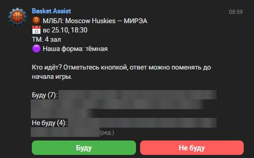
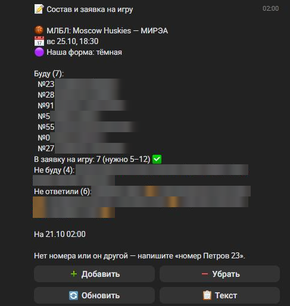
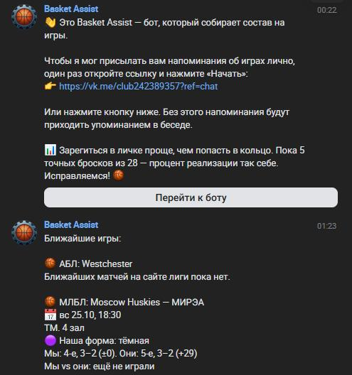

# Basket Assist

Бот VK для любительской баскетбольной команды: сам берёт расписание с сайтов лиг, собирает состав на игру голосованием
«Буду / Не буду» в беседе команды и присылает капитану готовую заявку на игру — «номер + ФИО», проверенную по заявке на
сезон.

> Выпускная работа по курсу Claude Code. MVP работает на VPS и проходит пилот в реальной команде, которая играет в двух
> московских любительских лигах. Описание проекта — [`docs/course-project.md`](docs/course-project.md).

## Скриншоты

Реальная беседа команды во время пилота; имена игроков размыты.

<table>
<tr>
<td width="33%"></td>
<td width="33%"></td>
<td width="33%"></td>
</tr>
<tr>
<td><b>Анонс в беседе команды</b> — закреплён, кнопки «Буду / Не буду», имена отметившихся обновляются после каждого нажатия</td>
<td><b>Капитану в личку</b> — состав с номерами, хватает ли игроков, кто отказался и кто молчит, кнопки правки и текст заявки на игру</td>
<td><b>«Игры» и напоминание</b> — ближайшая игра в каждой лиге, цвет формы, справка по сопернику</td>
</tr>
</table>

## Зачем
Капитан любительской команды каждую неделю вручную создаёт опрос в чате, пересчитывает ответы, напоминает молчащим и
переписывает номера и ФИО в заявку на игру. Игроки не всегда знают, когда и где игра; переносы замечаются поздно; легко
заявить игрока, которого нет в заявке на сезон. Basket Assist делает эту рутину сам.

## Что умеет
**Игрокам**
- анонс игры в беседе команды: лига, соперник, дата и время, зал, цвет формы, кнопки «Буду / Не буду» и имена
  отметившихся; анонс закреплён и обновляется после каждого нажатия;
- игры одной недели (две лиги) — в одном закреплённом анонсе, у каждой игры свои кнопки;
- напоминание тем, кто не ответил (в личку с кнопками или упоминанием в беседе);
- перенос или смена времени — новый опрос: сообщение о переносе и свежий анонс, старый удаляется;
- «Игры» — ближайшая игра в каждой лиге со справкой по сопернику: места и результаты обеих команд в таблице, очные
  встречи сезона; «Мои данные» — привязка к заявке на сезон и номер.

**Капитану, заместителю и и. о. капитана**
- сводки за 24 ч и за 2 ч до игры: кто идёт, кто отказался, кто молчит, хватает ли игроков (5–12);
- готовая заявка на игру отдельным сообщением — скопировать и подать на сайте лиги;
- сигнал, если игрок отметился «Буду», а в заявке на сезон этой лиги его нет;
- правка заявки на игру кнопками, ручной номер, ввод времени матча, если лига не опубликовала его на сайте;
- привязка участников беседы к заявкам на сезон с подсказками кандидатов (латиница, уменьшительные имена, составные
  фамилии), список «игроки» картинкой, передача прав временному и. о. капитана.

**Сам по себе**
- синхронизация расписания, таблицы и заявок на сезон с сайтов лиг (ночью полностью, ср–пт ежечасно), обнаружение
  переносов, смены времени, новых матчей и дозаявок;
- опрос в среду перед игрой, если время известно; нет времени — предупреждение капитану.

**Приватность:** бот обрабатывает в беседе только обращения к себе и свои кнопки, остальную переписку не читает и не
хранит; в личку пишет только тем, кто сам нажал «Начать»; хранит минимум данных.

## Как устроено
```
 VK (беседа, личка) ──► ChannelAdapter (VK, Long Poll) ──► обработчики бота ──┐
                                                                             ▼
 Сайты лиг (JSON API) ─► PlatformAdapter (MTGame, Infobasket) ─► синхронизация ─► SQLite ◄─ планировщик (каждую минуту):
                                                                                           опрос, напоминания, сводки,
                                                                                           сообщения о переносах
```
- Один asyncio-процесс на Python 3.13: бот, планировщик и синхронизация.
- Мессенджер и платформы лиг — за адаптерами: бизнес-логика не знает про VK, Telegram и MAX подключаются новым адаптером.
- Все данные привязаны к команде сервиса (`tenant_id`) — мультитенантность с первого дня.
- Подробно — [`docs/architecture.md`](docs/architecture.md), решения — [`docs/decisions/`](docs/decisions/).

**Стек:** Python 3.13, httpx (свой клиент VK API 5.199 и API лиг), SQLite + SQLAlchemy 2 + Alembic, Pillow,
pydantic-settings; pytest + pytest-asyncio + respx + pytest-xdist, ruff. Хостинг — VPS в российском дата-центре
(152-ФЗ), systemd, ежедневный бэкап.

## Структура
```
src/basket_assist/
  channels/   адаптер VK (ChannelAdapter)
  sources/    адаптеры платформ лиг: mtgame (АБЛ), infobasket (МЛБЛ)
  services/   логика: синхронизация, опросы и анонсы, недельный цикл, сводки, заявки на сезон, планировщик
  bot/        обработчики команд и кнопок (игроки, руководители)
  storage/    модели БД и миграции Alembic
tests/        ≈ 580 тестов; tests/fixtures — обезличенные ответы API лиг
deploy/       выкладка на VPS, systemd, бэкап (см. deploy/README.md)
docs/         видение, глоссарий, источники данных, архитектура, ADR
.claude/      субагент-тестировщик и скилл проекта для Claude Code
spikes/       одноразовые проверки гипотез (не код сервиса)
```

## Запуск
Нужны Python 3.13 и сообщество VK с ботом (ключ доступа сообщества с правами на сообщения и фото, включённый Bots Long Poll).

```sh
py -3.13 -m venv .venv
.venv/Scripts/python -m pip install -e ".[dev]"     # Linux/macOS: .venv/bin/python
cp .env.example .env                                 # VK_GROUP_TOKEN, VK_GROUP_ID
cp config/tenant.example.toml config/tenant.toml     # команда, лиги, беседа, капитан
.venv/Scripts/python -m basket_assist --check        # конфигурация и база (миграции)
.venv/Scripts/python -m basket_assist --sync --show  # синхронизация с лигами, ближайшие матчи
.venv/Scripts/python -m basket_assist                # запуск бота
```
На одном сообществе VK должен работать один экземпляр бота. Развёртывание на сервере — [`deploy/README.md`](deploy/README.md).

**Тесты и линтер:**
```sh
.venv/Scripts/python -m pytest -q -n auto
.venv/Scripts/python -m ruff check src tests scripts
```

## Как проект делался с Claude Code
- [`CLAUDE.md`](CLAUDE.md) — системные инструкции: домен, ограничения, правила работы, статус и следующие шаги;
- документация как источник истины: [`vision`](docs/vision.md), [`domain`](docs/domain.md) (глоссарий),
  [`data-sources`](docs/data-sources.md), [`open-questions`](docs/open-questions.md), 7 ADR;
- исследования параллельными субагентами (API ботов VK, сайты лиг, сравнение VPS) и проверка гипотез до кода
  (`spikes/`, живые проверки в тестовой беседе VK);
- субагент-тестировщик [`.claude/agents/tester.md`](.claude/agents/tester.md) — тесты, разбор падений, проверка на
  персональные данные;
- скилл проекта [`.claude/skills/basket-assist/`](.claude/skills/basket-assist/SKILL.md) — выкладка и откат, проверка
  синхронизации, переезд беседы, образцы API, новая лига, демо-режим.

## Планы
Подключение любой команды по ссылкам на лигу, Telegram и MAX, подробный скаутинг соперника (последние результаты), новые платформы лиг,
справочник залов.
